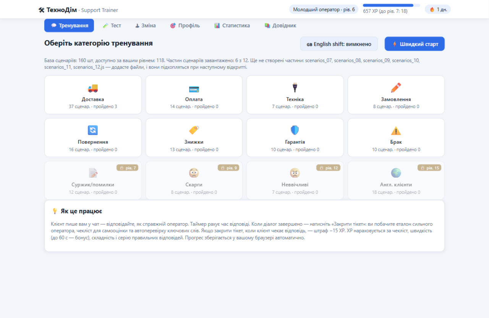
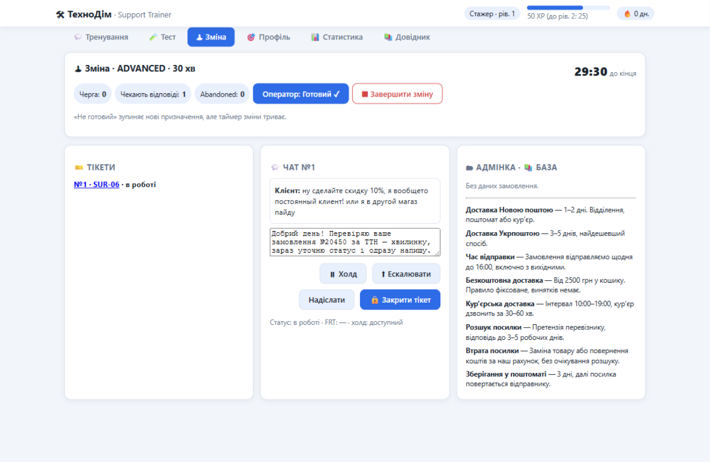
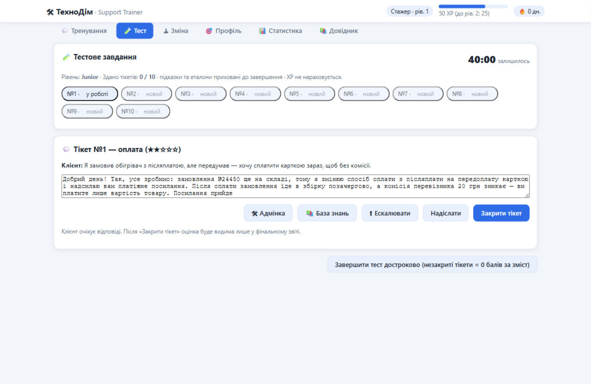
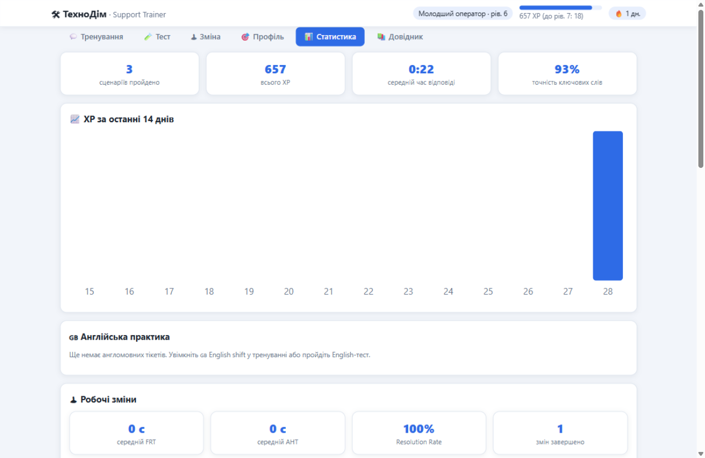

# 🛠 Chat Support Trainer 2.0 — «ТехноДім»

**Локальний тренажер операторів чат-підтримки інтернет-магазину.** Українською мовою, працює повністю офлайн — один `index.html` і кілька JS-файлів, без сервера, без залежностей, без збірки.

[🇬🇧 English version](README.en.md)



## Що це

Навчальна симуляція робочого дня оператора підтримки: клієнт пише в чат — ви відповідаєте, а застосунок оцінює відповідь за тим самим конвеєром, що й «наставник»: наявність фактів з еталона, ввічливість, ясність, безпека, ключові слова чекліста. 160 сценаріїв у 12 категоріях — від «де моя посилка» до подвійних списань і зниклих замовлень.

Проєкт задуманий як **портфоліо-кейс**: повне технічне завдання ([ROADMAP.md](ROADMAP.md)), поетапний журнал розробки з тестами та двома аудитами ([PLAN.md](PLAN.md)) публікуються разом із кодом — можна подивитися, як вимога перетворювалась у реалізацію і як її перевіряли.

## Можливості

### 💬 Тренування
- 160 сценаріїв, 12 категорій (доставка, оплата, повернення, знижки, гарантія, брак, суржик, скарги, складні кейси, англомовні клієнти…), розблокування за рівнем.
- Клієнт відповідає за сценарієм (follow-up-и), таймер, чернетка, шаблони відповідей.
- Після закриття тікету — розбір: еталон сильного оператора, чекліст, автоперевірка ключових слів, XP.
- Динамічне завантаження частин `scenarios_01..12.js` — додайте файл, і база розшириться без правок коду.

### 🧪 Тестове завдання (Job Assessment)
- 10 випадкових тікетів, 40 хвилин, без підказок і еталонів; адмінка та база знань доступні.
- Рівні: Junior / Intermediate / Advanced / English (англомовні тікети).
- Після завершення — середній QA Score / 100 і розбір кожного тікету. **XP у цьому режимі не нараховується** — режим не змішує навчання та контроль.

### 🕹 Live Shift — робоча зміна
- Зміна 15/30/45 хв: клієнти приходять за розкладом, до 2–3 паралельних чатів, надлишок — у чергу.
- Терпіння клієнта: 90 с без відповіді — «Ало?», ~3 хв — клієнт іде (abandoned).
- Статус оператора «Готовий / Не готовий», холд, ескалації, закриття тікетів.
- Метрики: FRT (перша відповідь), AHT, Resolution Rate, середній QA; XP-бонус лише при середньому QA ≥ 70.
- Стан переживає перезавантаження сторінки.



### 🧭 Система ескалацій
- 24 обов'язкові + 7 «сам вирішує» ситуації: правильний відділ, пріоритет, внутрішня нотатка, інформування клієнта.
- Пропущена обов'язкова ескалація б'є по оцінці й XP; ескалація «не в той відділ» обмежує максимальний бал.

### 🇬🇧 English Mode
- 18 англомовних сценаріїв + детектор ~67 типових граматичних помилок («I am agree», «will be arrive», «refund will back»…) з підказками; українські відповіді детектор не чіпає, на еталонах — нуль хибних спрацювань.



### 📊 Статистика і профіль
- XP, рівні, серії, бейджі, квести; статистика по категоріях, динаміка QA за 14 днів, топ повторюваних помилок, історія тестів і змін.



### 🔒 Дані і безпека
- Прогрес — у `localStorage` вашого браузера; покрокова міграція схеми з резервним ключем.
- Пошкоджений JSON не перезаписується: сирий рядок зберігається в окремому ключі, застосунок показує банер і працює у тимчасовому стані.
- Експорт/імпорт прогресу одним JSON-файлом (включно зі станом «Тесту» та змін).
- Заборонені теми (CVV/PIN, гарантії результату, грубощі) ловляться окремим списком FORBIDDEN і обнуляють довіру до відповіді.

## Технології

- **Vanilla JavaScript (ES5-сумісний стиль)** — жодних залежностей, фреймворків і збірки.
- **localStorage** — стан, міграції схеми, експорт/імпорт.
- **Інлайн-SVG** для графіків; CSS без препроцесорів.
- Працює з `file://` напряму (немає жодного `fetch`/XHR) і з будь-якого статичного хостингу.

## Запуск

**Варіант 1 — просто відкрити файл.** Подвійний клік на `index.html` — застосунок працює з `file://`.

**Варіант 2 — локальний сервер** (щоб мати окремий origin для тестів):

```bash
python -m http.server 8080
# відкрийте http://localhost:8080
```

**Варіант 3 — GitHub Pages.** Увімкніть Pages у налаштуваннях репозиторію (гілка `main`, корінь) — більше нічого не потрібно: усі шляхи відносні.

## Як це оцінює відповіді (прозоро)

Оцінка — детермінований конвеєр без нейромереж: базові перевірки (привітання, КАПС, емпатія) → витяг фактів еталона за стемами з розпізнаванням заперечень → суперечності → FORBIDDEN → граматика → чекліст → 6 критеріїв якості → QA Score / 100 і XP. Це навчальна симуляція, а не ідеальний суддя: **лексичні синоніми поза словником стемів рахуються як промах факту**. Ми свідомо не імітуємо «розуміння змісту» — натомість правила оцінювання чесно задокументовані й однакові для тренування, тесту та зміни.

## Обмеження

- Оцінювання стемове: синоніми, яких немає у словнику сценарію, не розпізнаються.
- Сценарії мають фіксовані follow-up-и — це симуляція, а не жива розмова.
- Усі компанії, товари, номери замовлень і клієнти вигадані; збігів з реальністю не передбачається.
- Це навчальний проєкт: метрики (FRT/AHT/Resolution) — тренажерні, не еталон реальних контакт-центрів.

## Структура репозиторію

```
chat-support-trainer/
├── index.html          # застосунок: UI, конвеєр оцінювання, міграції, статистика
├── scenarios.js        # базові сценарії
├── scenarios_01..06.js # додаткові частини (кожна додає 25–30 сценаріїв)
├── assessment.js       # Job Assessment Mode
├── shift.js            # Live Shift Mode
├── escalation.js       # система ескалацій
├── eng-mistakes.js     # детектор типових англійських помилок
├── ROADMAP.md          # технічне завдання
├── PLAN.md             # журнал розробки: етапи, тести, аудити
└── docs/screenshots/   # скриншоти
```

## Розширення бази сценаріїв

Створіть `scenarios_07.js` за зразком наявних частин — кожен сценарій це об'єкт із категорією, складністю, першим повідомленням, follow-up-ами клієнта, еталонною відповіддю, ключовими фактами та правилами ескалації. Завантажувач підхопить файл автоматично (до 12 частин), навіть якщо ви відкрили застосунок просто з диска.
